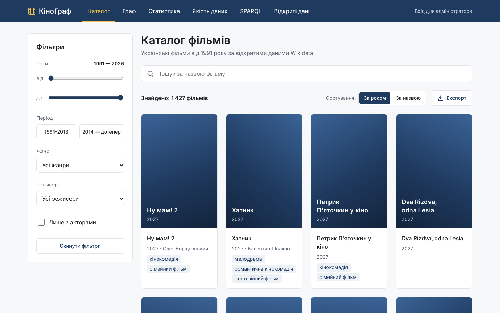
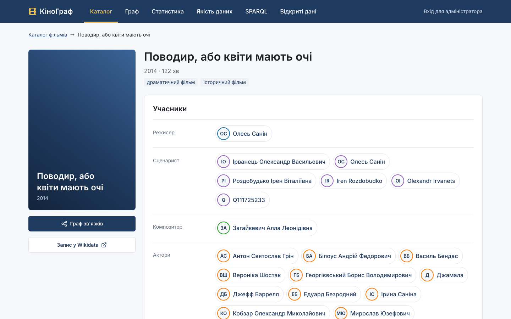
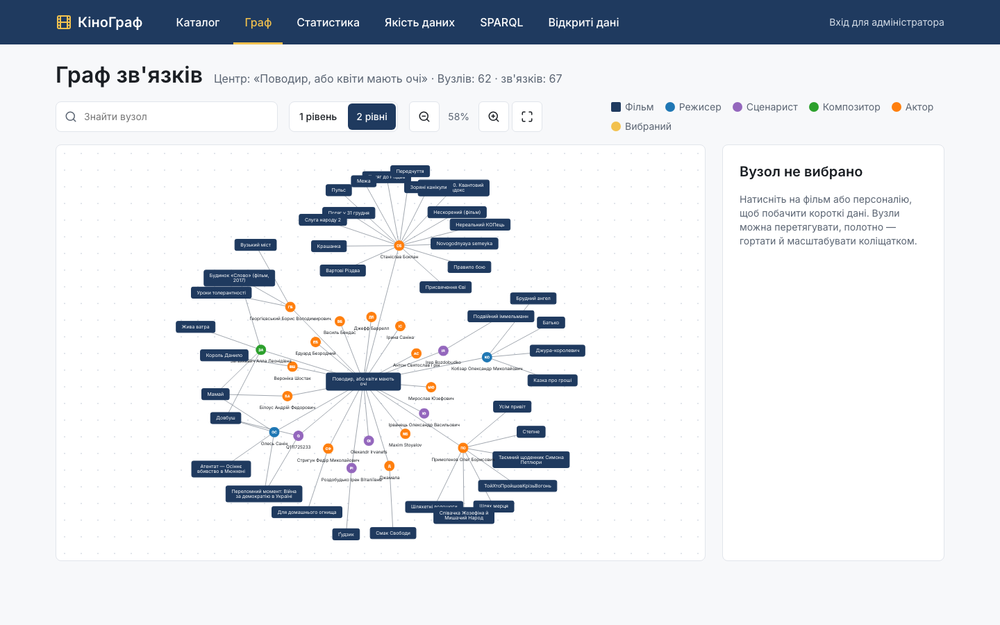

# КіноГраф

Вебзастосунок-довідник українських фільмів від 1991 року, побудований на зв'язаних відкритих даних [Wikidata](https://www.wikidata.org). Застосунок отримує дані через SPARQL, подає їх як каталог, сторінки фільмів і персоналій, граф зв'язків і статистику, перевіряє записи за правилами SHACL і сам публікує дані як зв'язані відкриті дані з постійними адресами.

Проєкт з дисципліни «Принципи, методи зв'язування даних у застосуваннях Semantic Web», магістратура ФІТ КНУ імені Тараса Шевченка.

## Стан роботи

| Етап | Стан |
|---|---|
| Проєкт застосунку: аналіз, UML-діаграми, макети | виконано |
| Модуль відкритих даних | реалізовано, покрито тестами |
| Сховище, рівень доступу до даних, рівень програми (REST API) | реалізовано, покрито тестами |
| Рівень інтерфейсу | реалізовано, покрито тестами компонентів |
| Docker Compose | реалізовано, перевірено |
| Зв'язані відкриті дані: постійні адреси, VoID, точка SPARQL, перевірка SHACL | реалізовано, покрито тестами |
| Приймальні тести (Playwright, 17 сценаріїв) | реалізовано |
| Фінальна перевірка: справжні дані, покриття, перевірка безпеки | виконано |

## Макет

Еталонні екрани в десктопній (1440 px) і мобільній (390 px) версіях — у теці [`design/screens`](design/screens), інтерактивний прототип — [`design/prototype/KinoGraf.html`](design/prototype/KinoGraf.html), усі стани екранів — на дошках [`design/figma-board`](design/figma-board). Інтерактивний прототип у Figma: https://www.figma.com/design/0Xilac0MOvyFZHqwQe0Dt7/Uni-Project?node-id=0-1.

## Знімки екранів

| Каталог | Картка фільму |
|---|---|
|  |  |
| **Граф зв'язків** | **Статистика** |
|  |  |

Усі десять екранів у десктопній (1440 px) і мобільній (390 px) версіях — у теці [`docs/screenshots`](docs/screenshots). Знімки знято з даними Wikidata станом на 15.11.2026: 1 427 фільмів, 2 804 персоналії. Оновити їх можна на запущеному застосунку:

```bash
cd e2e
KINOGRAF_ADMIN_KEY=... npm run screenshots
```

## Джерело даних

Фільми відбираються у Wikidata за трьома ознаками: це фільм (`P31` = `Q11424`), країна походження Україна (`P495` = `Q212`), дата виходу (`P577`) від 1991 року. Учасники беруться з властивостей режисер (`P57`), сценарист (`P58`), композитор (`P86`) і актори (`P161`), а також завантажуються жанри (`P136`), нагороди (`P166`) і посилання на інші набори: ідентифікатор IMDb (`P345`) і статті української та англійської Вікіпедії. Дані Wikidata поширюються за ліцензією CC0.

## Відкриті дані

КіноГраф не лише бере дані з Wikidata, а й сам публікує їх як зв'язані відкриті дані (екран «Відкриті дані», `/open-data`). Опублікований граф `linked.ttl` будується під час оновлення у словнику [schema.org](https://schema.org) з власними URI; фільми й персоналії пов'язано з Wikidata і DBpedia (`owl:sameAs`), IMDb і українською Вікіпедією (`schema:sameAs`).

П'ять зірок відкритих даних за шкалою Тіма Бернерса-Лі:

| | Вимога | Як виконано |
|---|---|---|
| ★ | Доступні в інтернеті з відкритою ліцензією | CC0 1.0, як і дані Wikidata |
| ★★ | Структуровані й придатні для обробки програмами | граф RDF, таблиці CSV і JSON |
| ★★★ | У відкритих форматах | Turtle, JSON-LD, CSV |
| ★★★★ | Сутності позначено адресами URI | `/id/film/{qid}`, `/id/person/{qid}` |
| ★★★★★ | Зв'язані з іншими наборами | Wikidata, DBpedia, IMDb, Вікіпедія |

| Адреса | Що повертає |
|---|---|
| `/id/film/{qid}`, `/id/person/{qid}` | `303 See Other` за заголовком `Accept`: Turtle, JSON-LD або сторінку застосунку |
| `/data/film/{qid}.ttl`, `.jsonld` (так само для `person`) | документ про сутність |
| `/.well-known/void` | опис набору у VoID: обсяг, ліцензія, набори зв'язків |
| `/data/kinograf.ttl` | увесь набір одним файлом Turtle |
| `/data/sparql` | точка доступу за протоколом SPARQL 1.1 (`SELECT` і `ASK`) |

Усі адреси будуються від `KINOGRAF_BASE_URL` (типово `http://localhost:8080`); після її зміни треба оновити дані. Відповіді цих маршрутів мають `Access-Control-Allow-Origin: *`, тож дані можуть використовувати інші сайти. На сторінках фільмів і персоналій є розмітка schema.org у JSON-LD.

```bash
# дані фільму «Поводир» у Turtle: постійна адреса перенаправляє на документ
curl -L -H "Accept: text/turtle" http://localhost:8080/id/film/Q12141247

# той самий фільм у JSON-LD
curl -L -H "Accept: application/ld+json" http://localhost:8080/id/film/Q12141247

# опис набору й увесь набір
curl http://localhost:8080/.well-known/void
curl -o kinograf.ttl http://localhost:8080/data/kinograf.ttl

# запит до точки SPARQL: результат у SPARQL JSON або CSV
curl --data-urlencode 'query=SELECT (COUNT(?film) AS ?films) WHERE { ?film a schema:Movie }' \
  http://localhost:8080/data/sparql
curl -H "Accept: text/csv" --data-urlencode 'query=SELECT ?film ?imdb WHERE { ?film schema:sameAs ?imdb FILTER(STRSTARTS(STR(?imdb), "https://www.imdb.com/")) } LIMIT 5' \
  http://localhost:8080/data/sparql
```

### Перевірка за правилами SHACL

Наприкінці кожного оновлення локальний граф у термінах Wikidata перевіряється бібліотекою pyshacl за десятьма правилами з [`backend/kinograf/rdf/shapes.ttl`](backend/kinograf/rdf/shapes.ttl): помилки (дата виходу, тривалість від 1 до 600 хв), попередження (назва українською, режисер, актори, жанр) і підказки (тривалість, сценарист, зображення, фільм уже вийшов). Результати видно на екрані «Якість даних» у розділі «Перевірка за правилами»: таблиця правил, фільми із зауваженнями й посилання «Виправити у Wikidata» з якорем потрібної властивості. Правила й звіт останньої перевірки можна завантажити: `/api/quality/shapes.ttl`, `/api/quality/report.ttl`.

## Структура репозиторію

```
backend/
  kinograf/
    config.py        налаштування зі змінних середовища
    models/          моделі предметної області
    opendata/        клієнт і завантажувач Wikidata, SPARQL-запити
    repositories/    доступ до SQLite з повнотекстовим пошуком FTS5
    rdf/             робоча копія Wikidata, опублікований граф schema.org, VoID, правила SHACL
    services/        логіка застосунку й об'єкти передачі даних
    api/             REST API на FastAPI і маршрути зв'язаних даних
    update.py        оновлення даних з командного рядка
  tests/             тести pytest
  Dockerfile         образ контейнера api
frontend/
  src/               інтерфейс на React: сторінки, компоненти, клієнт API
  tests/             тести Vitest і Testing Library
  Dockerfile         образ контейнера web (nginx)
  nginx.conf         статичні файли й проксі /api, /id, /data, /.well-known/void
e2e/                 приймальні тести Playwright і підставна Wikidata з тестовими даними
docker-compose.yml   запуск застосунку однією командою
docs/                специфікація, план реалізації, UML-діаграми (PlantUML і PNG), знімки екранів
design/              макети екранів, дошки для Figma, дизайн-токени
tools/figma-plugin/  плагін, що розставляє переходи в прототипі Figma
CONTRIBUTING.md      правила розробки: джерела вимог, стек, стиль коду
```

## Запуск у Docker

Потрібен Docker з Compose v2.24 або новішим.

```bash
cp .env.example .env          # задайте власний KINOGRAF_ADMIN_KEY
docker compose up --build
```

Застосунок відкривається на http://localhost:8080, документація API — на http://localhost:8080/api/docs. Контейнер `web` (nginx) віддає інтерфейс і передає запити `/api`, `/id`, `/data` і `/.well-known/void` контейнеру `api` (uvicorn). База SQLite, графи `graph.ttl` і `linked.ttl` та звіт перевірки SHACL зберігаються в томі `kinograf-data`, тому не зникають після перезапуску. Якщо застосунок доступний за іншою адресою, задайте її в `KINOGRAF_BASE_URL` у файлі `.env`: від неї будуються постійні адреси сутностей.

Після першого запуску довідник порожній. Дані завантажує адміністратор кнопкою «Оновити дані з Wikidata» на сторінці «Адміністрування» або командою:

```bash
docker compose exec api python -m kinograf.update
```

Одночасно може виконуватися лише одне оновлення: команда й кнопка в панелі не заважають одна одній. Оновлення проходить вісім етапів: фільми, учасники, жанри, нагороди, посилання, запис у сховище, публікація й перевірка якості. Запущений API сам підхоплює нові `graph.ttl` і `linked.ttl` після оновлення командою.

Оновлення триває кілька хвилин. Wikidata може обмежувати частоту запитів; паузу між повторами задає `KINOGRAF_RETRY_DELAY` (типово 60 с).

Якщо дані вже завантажено локально в `backend/data/`, їх можна перенести в том без звернення до Wikidata (так само копіюються `linked.ttl` і `shacl-report.ttl`, якщо вони є):

```bash
docker compose cp backend/data/kinograf.db api:/app/data/kinograf.db
docker compose cp backend/data/graph.ttl api:/app/data/graph.ttl
docker compose exec -u root api chown kinograf /app/data/kinograf.db /app/data/graph.ttl
docker compose restart api
```

## Розробка

Потрібні Python 3.12 і Node.js 22 або новіший.

Сервер:

```bash
cd backend
python -m venv .venv
source .venv/bin/activate
pip install -e ".[dev]"

python -m kinograf.update     # завантаження даних з Wikidata у backend/data/
uvicorn kinograf.api.app:create_app --factory --reload --port 8000
pytest                        # тести з вимірюванням покриття
ruff check . && ruff format --check .
```

Інтерфейс (в іншому терміналі; Vite перенаправляє `/api`, `/id`, `/data` і `/.well-known/void` на `localhost:8000`):

```bash
cd frontend
npm install
npm run dev                   # http://localhost:5173
npm test
npm run lint
```

Приймальні тести (17 сценаріїв за прецедентами з `docs/uml/01_usecase.puml`) самі запускають API на тестових даних і інтерфейс, тому потрібні лише встановлені залежності сервера й інтерфейсу:

```bash
cd e2e
npm install
npx playwright install chromium
npm test
```

## Безпека

- SPARQL-консоль приймає лише `SELECT`, а точка `/data/sparql` — `SELECT` і `ASK`; обидві забороняють `SERVICE` і `FROM`, обмежують запит 10 с і 1 000 рядків; запит, що перевищив час, переривається, а одночасно виконуються не більше двох.
- Заголовок `Access-Control-Allow-Origin: *` є лише на маршрутах зв'язаних даних (`/id`, `/data`, `/.well-known/void`), а не на REST API.
- Адміністративні дії доступні лише з ключем `KINOGRAF_ADMIN_KEY` у заголовку `X-Admin-Key`; ключ зберігається тільки в пам'яті вкладки.
- Параметри запитів мають межі (роки, номер сторінки, довжина тексту), значення CSV, схожі на формули, екрануються.
- nginx працює без прав root, додає заголовки безпеки (CSP, `X-Frame-Options`, `X-Content-Type-Options`) і обмежує частоту запитів до SPARQL-консолі, точки `/data/sparql` і адміністрування; контейнери мають обмеження пам'яті й процесора.
- Залежності перевіряються `npm audit` і `pip-audit`; версії для образу api зафіксовано в `backend/requirements.lock`.

## Стандарт коду

Серверний код відповідає PEP 8 (перевірка `ruff`), кожен модуль, клас і функція мають docstring у стилі Google. Інтерфейс перевіряє ESLint. Тести й перевірка стилю запускаються автоматично в GitHub Actions на кожну зміну.

## Ліцензія

Код поширюється за ліцензією MIT, дані Wikidata — за ліцензією CC0.
